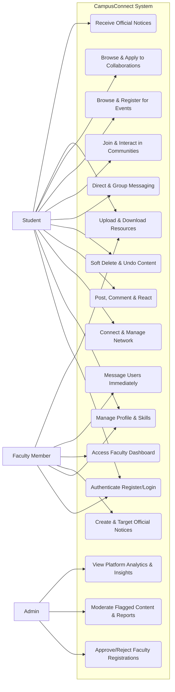
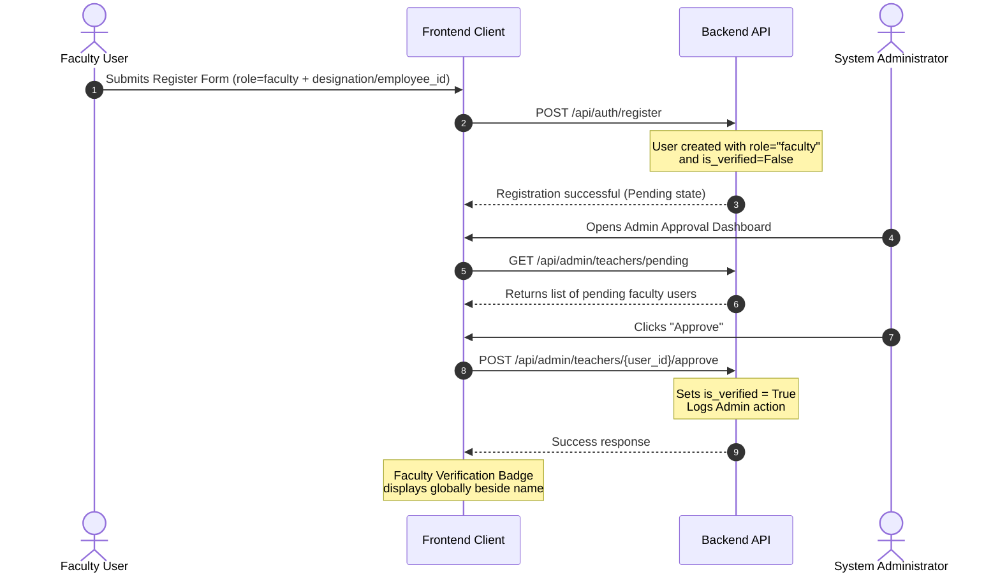
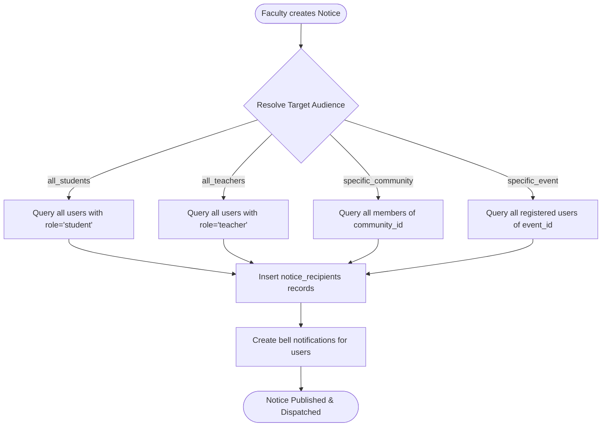
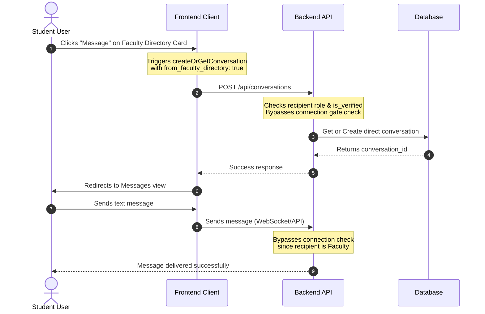

# CampusConnect Synopsis Diagrams

This document contains visual diagrams for the CampusConnect platform's synopsis, representing the system's actors, core use cases, and workflows.

---

## 1. Use Case Diagram

The Use Case diagram illustrates the interactions between different user roles (**Student**, **Faculty**, and **Admin**) and the platform's features using a flowchart layout.

---

## 2. Core Workflows

These workflow diagrams trace key business logic processes inside the system.

### A. Faculty Verification & Approval Workflow

This sequence shows the path of a faculty registration from submission to badge activation.

### B. Official Notice Targeting & Dispatch (Fan-out)

This diagram shows how notices are published and targeted to specific student groups.

### C. Faculty Directory Instant Messaging (Connection Bypass)

This workflow shows the bypass security rule that allows users to message faculty directly without needing a connection first.

